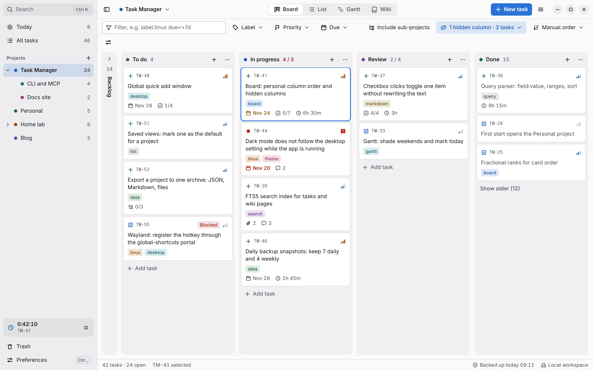
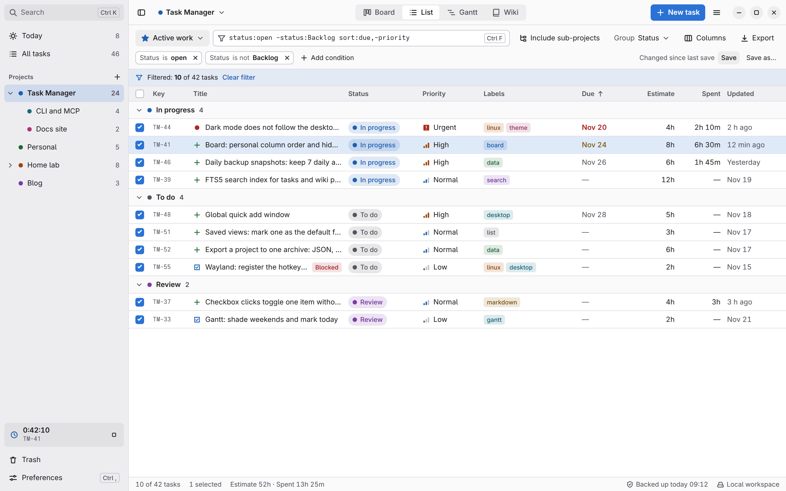
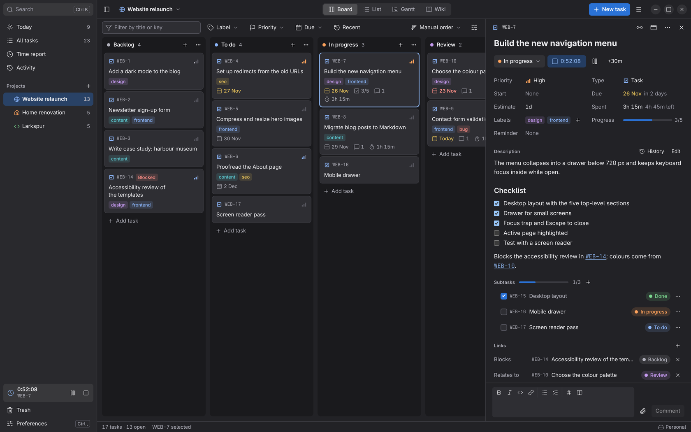
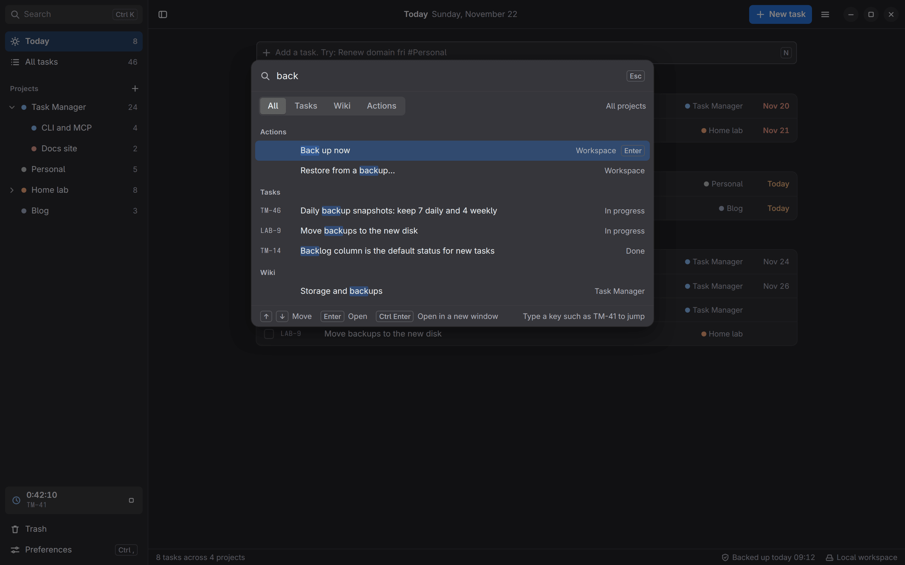
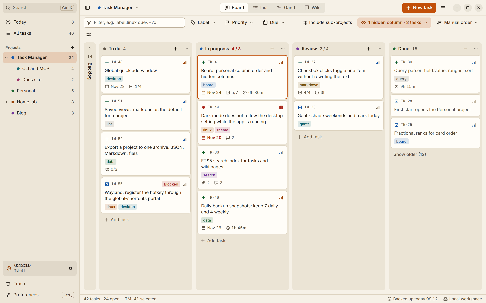
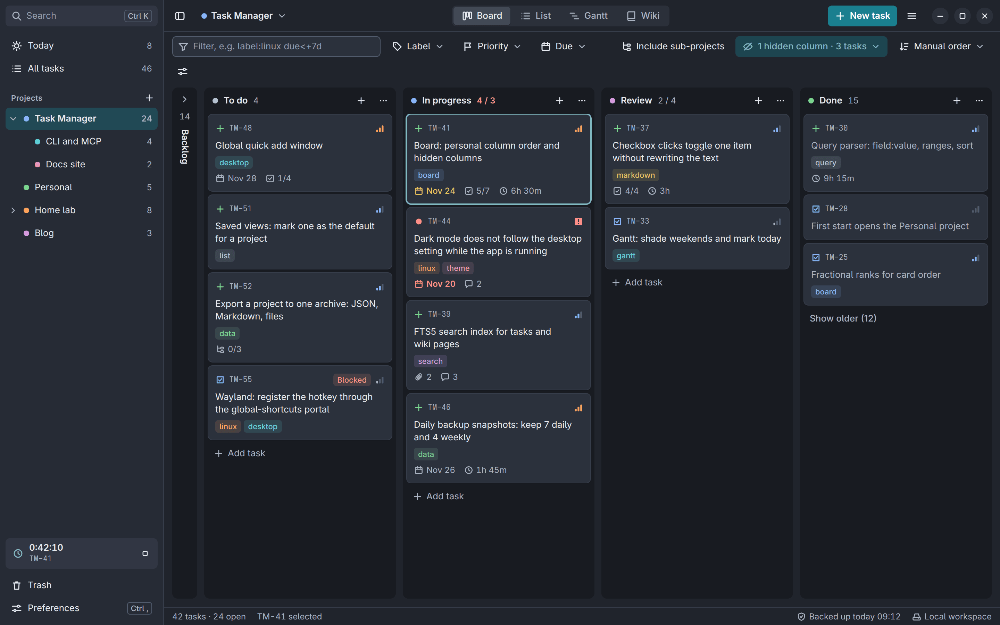
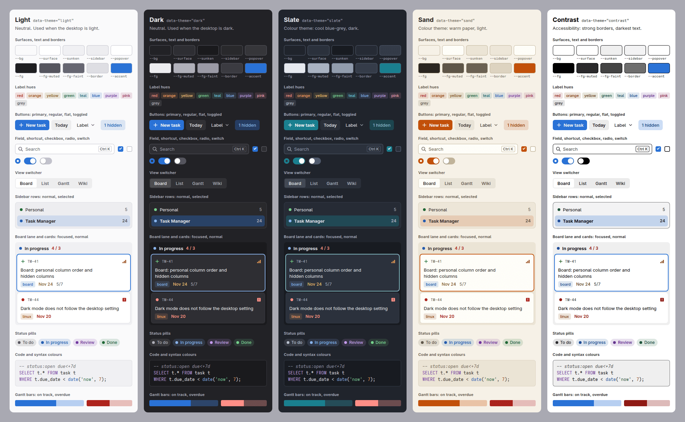
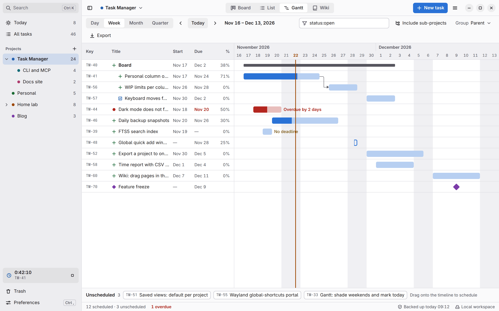
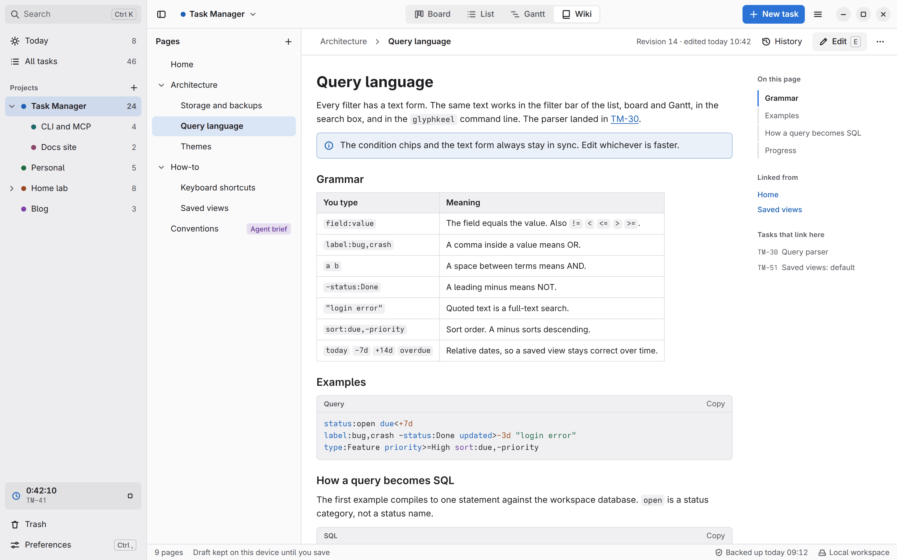

<div align="center">

# Glyphkeel

**A local-only desktop task manager with boards, lists, a Gantt chart, a wiki,
a command line and a built-in MCP server.**

[](LICENSE)
[](#status-and-roadmap)
[](#status-and-roadmap)



<sub>The board of version 0.1.0, with a running timer in the sidebar.</sub>

</div>

> [!IMPORTANT]
> Glyphkeel is in early development. The first release, 0.1.0, is being
> prepared, and nothing here is ready for daily use yet. The pictures in this README are screenshots of
> version 0.1.0, except the two marked as planned.

## Why

Most project trackers in the style of Jira or Redmine assume a server, an
account and a network connection. Glyphkeel is for one person on one computer:
it keeps every task, wiki page and attachment in a single folder on your disk,
needs no account, and contains no network code at all.

It is also built for working alongside coding agents. The desktop app, the
`glyphkeel` command line and the MCP server are three front ends over one
engine and one set of operations, so an agent can do the same things you can,
under rules you set, and every change it makes is recorded and can be undone.

## Planned features

**Projects and tasks**
- Projects with sub-projects, each with its own key, statuses, types and labels.
- Tasks with Markdown descriptions, checklists, subtasks, links, comments,
  attachments, estimates and due dates.
- History for every change, undo, revert, and a trash for deleted items.

**Views**
- Kanban board with a personal column layout: reorder, hide or collapse columns
  without changing the project.
- Task list with filters, grouping, bulk edit, saved views and export.
- Gantt chart with dependencies and milestones, and a calendar.
- Today view, global search and a command palette.
- A wiki per project, with a page tree, revisions and links to tasks.

**Query language**
- One text form for every filter, such as
  `status:open label:linux due<+7d sort:due,-priority`. It works the same in
  the filter bar, the search box and the command line.

**Time**
- Time entries, a running timer, remaining estimates and reminders as desktop
  notifications.

**Data**
- One SQLite database and a folder of attached files. Daily backups, restore,
  and export to plain JSON and Markdown.
- Never online: no account, no telemetry, no update checks.

**Desktop**
- Keyboard-first, with five themes (Light, Dark, Slate, Sand and a
  high-contrast theme), nine accent colours and a compact density.

## Working with AI agents (MCP)

Glyphkeel includes an [MCP](https://modelcontextprotocol.io/) server, so MCP
clients such as coding agents can read and update your tasks. The client starts
it as a local process, `glyphkeel mcp`, and talks to it over standard input and
output; nothing listens on the network.

- Every data operation available in the app is also available as an MCP tool.
- You choose what an agent may do: read only, standard, or full access, and
  optionally limit it to one project.
- Each change records which agent made it and in which session. An agent's
  whole session can be reviewed and reverted.
- Agents can claim a task for a while, so two agents don't pick up the same
  work.

The MCP server works while the app is closed. It is part of the command line,
not a separate service.
[Connecting MCP clients](docs/mcp-clients.md) has the set-up for common
clients, on Linux and on Windows (`glyphkeel.exe mcp`). Where your workspaces
and settings are kept, and how to move them, is in
[Data and settings](docs/data-and-settings.md).

## Screenshots

Screenshots of version 0.1.0, taken with a sample workspace.

<table>
  <tr>
    <td width="50%"><br><sub>Task list with a saved view, a query and grouping</sub></td>
    <td width="50%"><br><sub>Task panel with checklist, subtasks, links and a running timer (dark theme)</sub></td>
  </tr>
  <tr>
    <td width="50%"><br><sub>Command palette over the Today view (dark theme)</sub></td>
    <td width="50%"><br><sub>The board in the Sand theme</sub></td>
  </tr>
</table>

<details>
<summary>More: the Slate theme and all five themes side by side</summary>

<br>



<sub>The board in the Slate theme</sub>



<sub>The board in the Light, Sand, Slate, Dark and Contrast themes</sub>

</details>

### Planned

These two features are not built yet. The pictures are design previews,
rendered from the UI design, not screenshots of the app.

<table>
  <tr>
    <td width="50%"><br><sub>Design preview: Gantt chart with dependencies, a milestone and unscheduled tasks</sub></td>
    <td width="50%"><br><sub>Design preview: wiki page with a page tree, outline and links to tasks</sub></td>
  </tr>
</table>

## Status and roadmap

Glyphkeel is being built in the open, in vertical slices: each slice adds a
feature to the engine, the MCP server, the command line and the app together.

- **Now:** version 0.1.0, the first release, is being prepared. Projects, tasks and the board,
  task details, time tracking, the list and query language, search, history,
  the trash and backups work in the app, on the command line and through the
  MCP server.
- **Next:** feedback on 0.1.0, then the wiki in the app.
- **Later:** the Gantt chart and calendar, and deeper project
  settings such as custom fields, versions and recurring tasks.
- **Platforms:** Linux, packaged as deb, rpm and Flatpak, and Windows 10
  and 11, with a per-user installer ([Glyphkeel on Windows](docs/windows.md)).
  macOS is not planned at present.

Releases will appear on the [releases page](https://github.com/sorrelfox/glyphkeel/releases).

## Documentation

The [documentation](docs/README.md) has a user guide for the app, and guides to
[backup and restore](docs/backup-and-restore.md),
[the query language](docs/query-language.md),
[the command line](docs/cli.md) and
[working with AI agents](docs/mcp.md).

## Building from source

You need:

- **Rust** through [rustup](https://rustup.rs/). The toolchain is pinned in
  `rust-toolchain.toml`, and rustup installs it on first use.
- **Node** 24 (the exact version is in `.node-version`) with Corepack, which
  provides the pinned pnpm.
- **WebKitGTK 4.1, GTK 3 and libsoup 3** with their development files:
  - Debian and Ubuntu: `sudo apt install build-essential pkg-config libwebkit2gtk-4.1-dev libgtk-3-dev libsoup-3.0-dev librsvg2-dev`
  - Fedora: `sudo dnf install gcc gcc-c++ pkgconf-pkg-config webkit2gtk4.1-devel gtk3-devel libsoup3-devel librsvg2-devel`

Then:

```sh
git clone https://github.com/sorrelfox/glyphkeel.git
cd glyphkeel
corepack enable                  # provides the pinned pnpm
pnpm install --frozen-lockfile   # the UI's build tools
pnpm build                       # the UI, into ui/dist
cargo build -p gk-app --features tauri/custom-protocol
./target/debug/glyphkeel-app     # the desktop app, with the UI embedded
cargo run -p gk-cli -- --help    # the command line, `glyphkeel`
```

For UI work, `pnpm tauri dev` runs the app against the UI's development
server. [CONTRIBUTING.md](CONTRIBUTING.md) describes the layout of the
repository, the checks and the code requirements.

## Contributing

The project is young and changes quickly, so please open an issue to discuss a
change before you spend time on a pull request. Read
[CONTRIBUTING.md](CONTRIBUTING.md) first: commits follow Conventional Commits
and carry a `Signed-off-by` line (Developer Certificate of Origin), and pull
requests go to the `dev` branch.

Please report security problems privately, as described in
[SECURITY.md](SECURITY.md).

## The name

A keel keeps a boat on its course. Glyphkeel is a sibling of
[Glyphvane](https://github.com/sorrelfox/glyphvane), a Markdown editor by the
same author: the vane reads the wind, the keel holds the course.

## Licence

Glyphkeel is free software, licensed under the
[GNU General Public License, version 3 or later](LICENSE). The licences of the
third-party software it contains are in
[THIRD-PARTY-NOTICES.txt](THIRD-PARTY-NOTICES.txt), which every package
installs and the app shows under Preferences > About.
