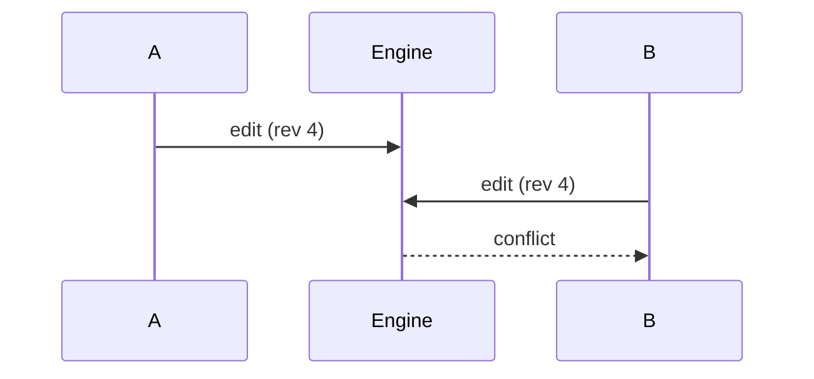

## Context

Users on the sync beta report that edits made offline are sometimes lost when two
devices reconnect within a few seconds of each other. This looks related to TM-41
(the revision counter) and possibly TM-57. See [[Sync design#Conflict rules|the conflict rules]]
and the [upstream discussion](https://example.com/issues/1234).

> [!IMPORTANT]
> Do not ship the fix without the migration in TM-63, otherwise old clients will
> keep writing the legacy `rev` column.

## Steps to reproduce

1. Open the same task on two devices.
2. Go offline on device A and edit the description.
3. Edit the title on device B while A is still offline.
4. Bring A back online within **5 seconds**.

## Plan

- [x] Write a failing integration test
- [x] Add a `last_seen_rev` column
- [ ] Compare revisions before applying a remote edit
  - [ ] handle the title field
  - [ ] handle the description field
- [ ] Update the conflict toast copy
- [ ] Ask QA to rerun the offline suite (TM-70)

The expected merge cost is $O(n \log n)$ in the number of edits, and the worst case is

$$
T(n) = \sum_{i=1}^{n} \left( c_1 + c_2 \log i \right)
$$

```rust
fn apply_remote(local: &Task, remote: &Edit) -> Result<Task, Conflict> {
    if remote.base_rev < local.rev {
        return Err(Conflict::Stale { local: local.rev, remote: remote.base_rev });
    }
    Ok(local.with(remote))
}
```

| Field       | Strategy        | Owner |
|-------------|-----------------|:-----:|
| title       | last writer wins | TM-41 |
| description | three-way merge | TM-57 |
| checklist   | per-item toggle | TM-63 |



<details><summary>Logs</summary>

```
2026-11-20T10:01:02Z WARN sync: stale base rev=4 local=5
```

</details>

Press <kbd>Ctrl</kbd>+<kbd>Enter</kbd> to retry.[^1]

[^1]: Only on desktop builds.
