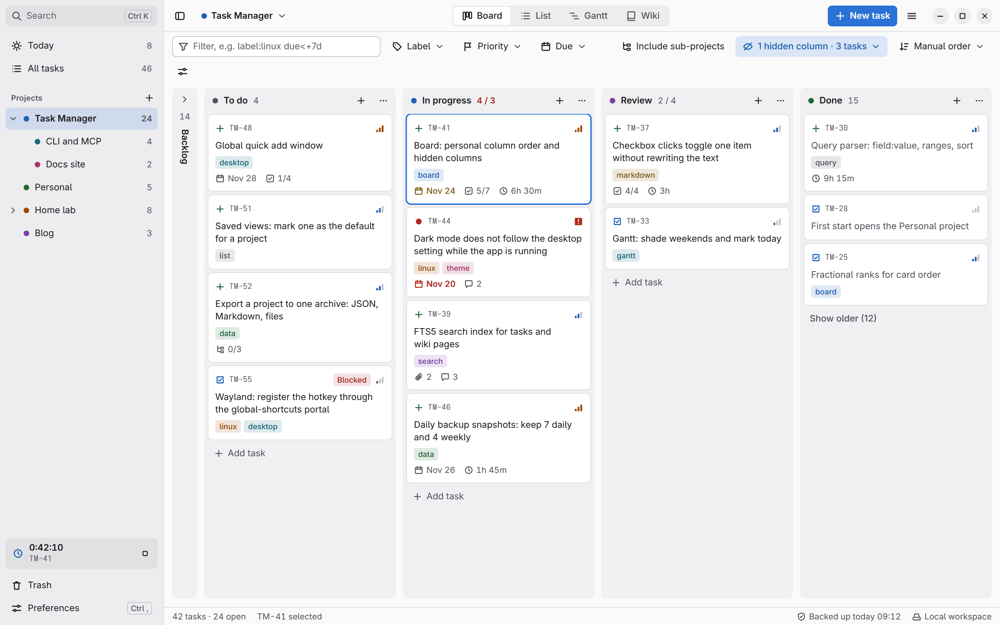

<!-- SPDX-License-Identifier: GPL-3.0-or-later -->

# The board

The board shows a project's tasks as cards in columns, one column for each
status. Open it with **Board** in the header bar, or Ctrl+1.

## Moving cards

- **Drag** a card to another column, or to another place in its column.
- **With the keyboard:** select a card and press Space to pick it up. The arrow
  keys move it between and within columns. Space drops it, and Escape cancels.
- **Shortcuts:** Alt and an arrow key move the selected card to the column on
  the left or right, or up and down in its column.
- **Card menu:** right-click a card, or press the menu key, for **Open**,
  **Move to**, **Priority**, **Copy key** and **Move to trash**.

Enter opens the selected card, and the arrow keys move between cards.

A move that a [status rule](rules.md) doesn't allow is refused, with the reason:
for example a field that must be filled in first.

## Your own layout

How you arrange the board is your own layout: it changes nothing in the
project's set-up. In each column's menu you can:

- **Hide** the column. The bar above the board says how many columns and tasks
  are hidden; click it to show a column again;
- **Collapse** it to a narrow strip;
- **Move left** and **Move right**. Alt+Shift and an arrow key move the column
  of the selected card;
- **Sort** it by **Manual order**, **Priority**, **Due date** or **Last
  updated**. In a sorted column, cards can't be moved by hand.

**Reset to project layout** goes back to the project's order.

The board options button sets the **Card fields** (Labels, Due date,
Checklist, Subtasks, Start date, Estimate, Days in column, and custom fields),
the card size (**Regular** or **Compact**) and **Hide closed cards after** a
number of days. A column with hidden closed cards has **Show older**.

## Filtering

The filter bar above the board narrows the cards:

- **Filter by title or key**;
- **Label**, **Priority** and **Due**: Overdue, Due today, Due in the next 7
  days or No due date;
- **Recent**: recently updated tasks.

The board says how many tasks the filter shows. **Clear filter** shows them all.
**Include sub-projects** adds the sub-projects' tasks.

For more complex filters, use the [list](list.md) and the
[query language](../query-language.md).

## WIP limits

A status can have a **WIP limit** and a **WIP minimum** (in Project settings ›
Statuses). The column header shows the count against the limit, such as `4 / 5`,
and marks a column that is over its limit or under its minimum. The limits are
shown as a warning; they don't stop a move.

## Cards

A card shows its key, title, type and priority, and the fields you chose. It
also shows comments, files, logged time, a **Blocked** mark when an open task
blocks it, and the agent that has claimed it.
