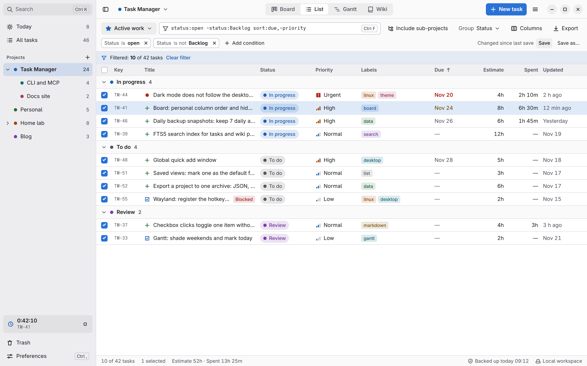

<!-- SPDX-License-Identifier: GPL-3.0-or-later -->

# The list and saved views

The list shows tasks as a table. Open a project's list with **List** in the
header bar, or Ctrl+2. **All tasks** in the sidebar is the same list over every
project.



## Filtering with a query

The field above the table takes a query (Ctrl+F puts the focus there):

```text
is:open label:bug due<+7d sort:due,-priority
```

It completes fields, operators and names as you type, and points out a mistake
with a suggestion. Each condition also shows as a chip under the field. Remove a
chip to drop its condition, or choose **Add condition** to build one without
typing. A query that chips can't show, for example one with `OR`, shows
**Advanced query · edit as text**.

[The query language](../query-language.md) explains queries with examples.

**Include sub-projects** adds the tasks of the sub-projects. **Clear filter**
empties the query.

## Columns, sorting and grouping

- **Columns** chooses the columns: Key, Title, Project, Type, Status, Priority,
  Labels, Version, Start, Due, Estimate, Spent, Remaining, Progress, Created,
  Updated, and custom fields. Drag a column's edge to change its width.
- Click a column header to sort by it, and again to reverse the order.
  Shift-click adds a second sort key.
- **Group** groups the rows by **Status**, **Priority**, **Label**, **Parent**,
  **Due week**, **Project** or a custom field. Each group has **Add task**, to
  add a task with the group's value.
- The foot of the table shows **totals** of the estimate, the time spent and the
  time remaining.

## Changing tasks in the list

- **Inline:** click a title, a status, a priority or a due date to change it.
  F2 edits the title of the selected row.
- **Selecting:** tick rows, or press Space on a row. Ctrl+A selects all, and
  Escape clears the selection.
- **Bulk changes:** with tasks selected, the bar above the table offers
  **Status…**, **Priority…**, **Add label…**, **Remove label…**, **Set a
  field…** and **Move to project…**. Glyphkeel shows a preview first and makes
  the change as one step, so a single Undo takes it back.
- Delete moves the selected tasks to the trash.

## Saved views

A saved view keeps a query with its columns, sort order, grouping and totals.
The **Saved views** menu lists the views of **This project** and of **All
projects**.

- **Save as…** saves the current list as a new view. Choose whether it is for
  this project or all projects, and whether to **Show it first when the list
  opens**.
- When you change a view, it shows **Changed since last save**. **Save** keeps
  the change.
- **Rename…**, **Make default**, **Stop being the default** and **Delete view**
  are in the same menu.

Saved views are shared with the command line (`glyphkeel view list`) and with
agents. When you rename a status, label or project key, the views that name it
are updated.

## Export

**Export** writes the tasks of the list to a file, as **CSV** or **JSON**.
