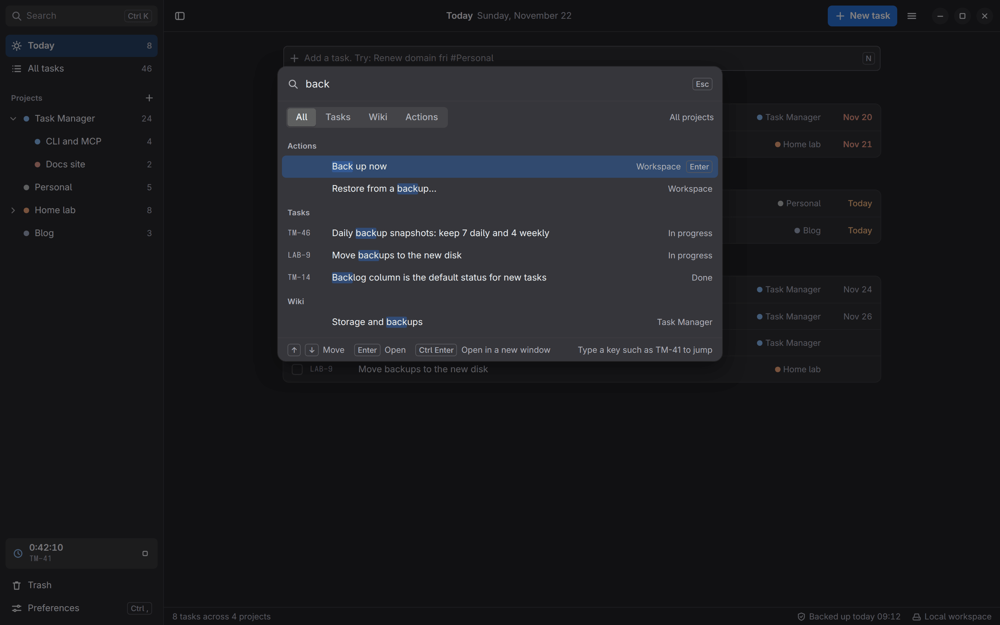

<!-- SPDX-License-Identifier: GPL-3.0-or-later -->

# Today, search and the palette

## Today

**Today** in the sidebar shows what needs attention across all projects:

- **Overdue** tasks and tasks **Due today**;
- tasks **In progress**;
- today's **Reminders**;
- **Agents at work**: tasks that agents have claimed, and until when;
- tasks **Changed in the last day**, and by whom;
- the **Timer**, when one runs.

The sidebar shows the counts next to **Today**. From the command line:
`glyphkeel today`.

### While you were away

When agents, automation rules or the command line changed something since you
last looked, Today starts with **While you were away**, a digest of it in
groups, each with a sentence that sums it up:

- **Agents**: each agent session that changed something, with its name, its
  client, how many changes it made and the tasks it touched. **Revert session**
  takes back everything that session changed (changes that something changed
  since are left as they are, and the message says how many), and **Open in
  Activity** shows only that session's changes.
- **Automation**: each rule that ran, with its runs and failures, why the last
  failure failed, and the tasks it acted on. **Run log** shows its latest runs,
  and **Revert its changes** takes back what its runs changed.
- **Reminders and due dates**: reminders that came due and that you haven't
  seen, and open tasks whose due day began while you were away.
- **Command line**: what you changed with `glyphkeel`, with the tasks it
  touched and **Revert these changes**.

Changes you made in the app aren't in it: you saw them. A task key opens the
task beside Today. **Inbox** in the sidebar shows how many entries the digest
has and goes to it.

**Mark as seen** clears the digest: the next one starts from the moment the
digest you saw was read, so anything that came in while you were reading it
still shows. That moment is yours alone, kept in the workspace and not in its
history, so it survives a restart and Undo doesn't move it back. Until you
mark it, the digest covers the last day.

With Preferences › Notifications › **Say at the start what agents did while
you were away** on, Glyphkeel says so in one notification when it starts, if
agents changed something since you last marked the digest as seen. It is off
until you turn it on, and needs desktop notifications on.

From the command line: `glyphkeel digest show` (with `--since yesterday` or a
moment for another start) and `glyphkeel digest dismiss`.

## Search

The **Search** field at the top of the sidebar suggests tasks, pages and
projects as you type. Enter, or **Search everything for …**, opens the search
view with all results.

The search finds words and parts of words in task titles and descriptions,
comments, wiki pages, file names and projects, and marks the matches. Use
`"a phrase"` for words in order, or a key such as `TM-41` to go to that task.
Narrow the results by **What to search** (Tasks, Comments, Wiki pages, Files or
Projects) and by **Project**.

From the command line: `glyphkeel search "release notes"`.

### Text inside attached files

Search also reads the text inside attached files: plain text, Markdown, CSV,
JSON and source code in any common encoding, the text of PDF documents, and
Word, Excel and PowerPoint (`.docx`, `.xlsx`, `.pptx`) and OpenDocument
(`.odt`, `.ods`, `.odp`) files. A result shows the file, its task and the
words around the match, such as *In file contract.pdf of TM-12: …*.

- A scanned PDF holds only pictures of its pages, so it is found by its name
  only: Glyphkeel doesn't recognise text in images.
- Files are read in the background a few seconds after they are attached,
  without other programs and without going online. Every file is treated as
  untrusted: at most 1 MB of text is kept per file, reading a file stops after
  10 seconds, and archives that would unpack to far more than their size (ZIP
  bombs) are refused.
- Files attached before the update are read once, in the background.
  **Preferences → Data → Search inside files** shows how far that has come, and
  **Read again** reads every file again.
- In an encrypted workspace the text is kept only inside the encrypted
  database.

In the list, `in:files` and `-in:files` choose whether the words of a query
are looked for inside files (see the [query language](../query-language.md)).

Search finds text. To filter tasks by their fields, use a
[query](../query-language.md) in the list.

## The command palette

Ctrl+K opens the palette. It searches tasks, projects and actions at once:

- type words to find a task, a project or an action such as *Back up now*;
- type a key such as `TM-41` to jump to the task;
- Tab limits the results to **Tasks**, **Projects** or **Actions**;
- the up and down arrow keys move, Enter opens, and Ctrl+Enter opens a task in a
  new window.

With an empty field, the palette shows what you opened recently.

## Quick add

Quick add captures a task without leaving what you are doing. Open it from the
**Main menu**, from the tray icon (**Quick Add…**), or with its global shortcut,
**Ctrl+Alt+Space** by default, from any program while Glyphkeel runs.

Type the title, and add to it:

- `#Project` picks the project, by its key or by its name without spaces
  (`#TM`, `#Personal`, `#homelab` for *Home lab*);
- `!high` sets the priority: `!urgent`, `!high`, `!normal` or `!low`, or `!1`
  (urgent) to `!4` (low);
- a date at the end sets the due date, such as `fri`, `tomorrow` or `dec 1`.

For example: `Renew domain fri #Personal !high`. The window shows what it
understood before you press Enter. If a date is meant to stay in the title,
choose **Keep “…” in the title**.

Change the shortcut in Preferences › **Quick add**. On some Linux desktops the
desktop asks once to allow it, or Glyphkeel can't hold the keys itself; then
Preferences shows the command to bind in the desktop's keyboard settings:
`glyphkeel-app --quick-add`.
