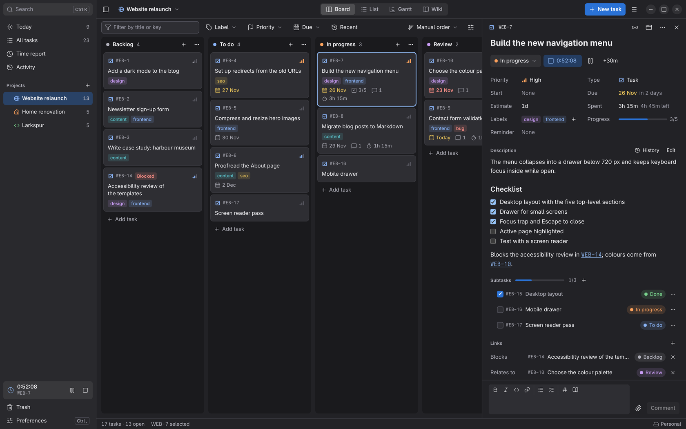

<!-- SPDX-License-Identifier: GPL-3.0-or-later -->

# Tasks

A task has a title, a status and a key such as `TM-41`. Everything else is
optional: a description, a type, a priority, labels, dates, an estimate,
progress, a version, custom fields, a reminder, a repeat rule, subtasks, links,
comments, files and logged time.

## Making a task

- **New task** in the header bar, Ctrl+N, or N when no text field has the
  focus.
- **Add task** at the foot of a board column, or **Add task to …** in its
  column menu. Type the title and press Enter.
- In the list, **Add task** in a group adds a task with that group's value.
- In the calendar, N adds a task due on the chosen day.
- **Quick add** (Ctrl+Alt+Space by default) works from any program while
  Glyphkeel runs ([Quick add](search.md#quick-add)).
- From a template: see [Templates](recurring-and-templates.md#templates).

## The task panel

Click a card or a row to open the task in the panel on the right. The panel has
the title, the status, the task's fields, the description, and sections for
subtasks, links, files, comments and history, and logged time.

**Open in its own window** in the task menu shows the task in a window of its
own; in the command palette, Ctrl+Enter does the same.

### Fields

| Field | What it holds |
|---|---|
| Status | The board column. Click it to choose another one |
| Priority | No priority, Low, Normal, High or Urgent |
| Type | A task type of the project |
| Start, Due | Dates. Type them in words, such as `next fri`, `in 3d` or `dec 1`, or pick one |
| Estimate | A duration, such as `1h 30m`, `90m`, `1.5h`, `2d` or `1w` |
| Spent | The time logged on the task, and how much is left or over the estimate |
| Labels | Labels of the project. Type a name that doesn't exist to create the label |
| Progress | A percentage |
| Version | The version the task is planned for ([Roadmap](roadmap.md)) |
| Reminder | A personal reminder ([Reminders](time.md#reminders)) |
| Repeats | A repeat rule ([Recurring tasks](recurring-and-templates.md#recurring-tasks)) |

Custom fields of the project follow, under **Fields** ([Custom fields](custom-fields.md)).
A day is 8 working hours and a week 5 working days unless you change them in
Preferences › Time.

### The description

The description is Markdown. Choose **Edit** to change it. Ctrl+Enter saves and
Esc cancels. The editor has a formatting toolbar, and it completes as you type:

- `#` and a word of a title, or the start of a key, links a task;
- `[[` and a page title links a wiki page, and `[[Page#Heading` a heading;
- `/` at the start of a word inserts a block: a table, a task list item, a code
  block, a math block, a Mermaid diagram, a callout or a heading.

Text you haven't saved is kept as a draft, also when the app closes. The next
time you edit, Glyphkeel offers **Continue editing** or **Discard them**.

Every saved version is kept. **History** next to the description lists the
revisions; choose two to compare them, and **Restore this revision** to bring
one back. [Links in Markdown](../reference/links.md) lists every kind of link.

**Conflict copies.** If the description changed elsewhere while you edited it,
for example by an agent, Glyphkeel merges the two changes when it can. When it
can't, your text is kept as a *conflict copy*, and the description says so.
**Resolve** shows the differences and offers **Keep current**, **Use the copy**
or **Merge by hand**.

### Checklists

A list item written `- [ ] …` is a checklist item, and `- [x] …` a ticked one.
Tick it in the description without editing. Cards show how many items are done.

### Subtasks

**Add subtask** under **Subtasks** makes a task inside this one, in the same
project. Subtasks can have subtasks, up to five levels. Tick a subtask to close
it, and use its menu to move it up or down. A parent's progress
counts its subtasks.

### Links

**Add link** under **Links** connects two tasks. The kinds are **Blocks**,
**Blocked by**, **Relates to**, **Duplicates**, **Duplicated by**, **Copy of**,
**Copied as**, **Subtask of** and **Parent of**. A *blocks* link can have a lag
in days, and the Gantt chart draws it as a dependency. A task with an open
blocker is marked **Blocked** on its card.

When you close a task that is the original of open duplicates, Glyphkeel asks
whether to close them too.

### Files

Drop files on the task, or choose **Attach files**. Images show a preview.
**Open** opens a file in its own program, and **Save a copy…** saves it
somewhere else. Removing a file moves it to the trash.

### Comments and history

The **Comments** tab holds the discussion. Ctrl+Enter sends a comment. A
comment can be edited (the earlier versions are kept) and moved to the trash.
**Quote in reply** quotes a comment, or the part of it you selected, with a link
back to it.

The **History** tab lists every change to the task: who made it, through which
program (the app, the command line or MCP) and when. Each change can be
reverted ([History](history-and-trash.md#the-history-of-a-task)).

### Time

The **Time** section logs time on the task and runs the timer
([Time tracking](time.md)).

## The task menu

| Item | What it does |
|---|---|
| Open in its own window | Shows the task in a window of its own |
| Duplicate | Copies the task with its subtasks, labels, checklist and files. The copy is linked as a copy |
| Duplicate without subtasks | The same, without the subtasks |
| Move to another project… | Moves the task, with its subtasks, comments, files, time and links. It gets a new key, and the old key still finds it |
| Save as template… | Makes a task template ([Templates](recurring-and-templates.md#templates)) |
| Release the agent's claim | Ends an agent's claim on the task |

When you move tasks to another project, Glyphkeel checks first. If the target
project has no status, type or label of the same name, you choose what each one
becomes there, or **Leave it off**. Custom field values and versions that the
target can't hold are listed, and required fields get a value.

## Deleting a task

Move a task to the trash with **Move to trash** in its card menu, or press
Delete on a selected card or row. Its subtasks go with it. Restore it from the trash
([The trash](history-and-trash.md#the-trash)).

## Agents and tasks

An agent can **claim** a task for a while, so that other agents leave it alone.
The card shows who claimed it, and Today lists claims under **Agents at work**.
Claims never block you. See [Working with AI agents](../mcp.md).
