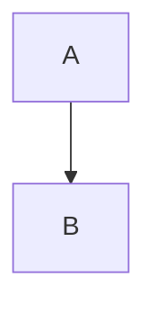

<svg onload=alert(1)>
[x](javascript:alert(1)) [y](JaVaScRiPt:alert(1)) [z](data:text/html,<b>x</b>)
<a href="java&#x09;script:alert(1)">t</a> <a href=" javascript:alert(1)">u</a>
 

s

<iframe src="https://example.org"></iframe>
<a href="gk-file://0b5e2c1a-7f3d-4e8a-9c21-5d6f7a8b9c0d">file</a> TM-41 [[Page#Heading|label]]
$x^2$ and $$\href{javascript:alert(1)}{x}$$

> [!warning] Callout <b onclick=x>bold</b>
- [ ] task <input type=text autofocus onfocus=alert(1)>
[^1]: note <a id="fn-x" name="x">
{{toc}} {{tasks: status = open}} {{include: Page}}
